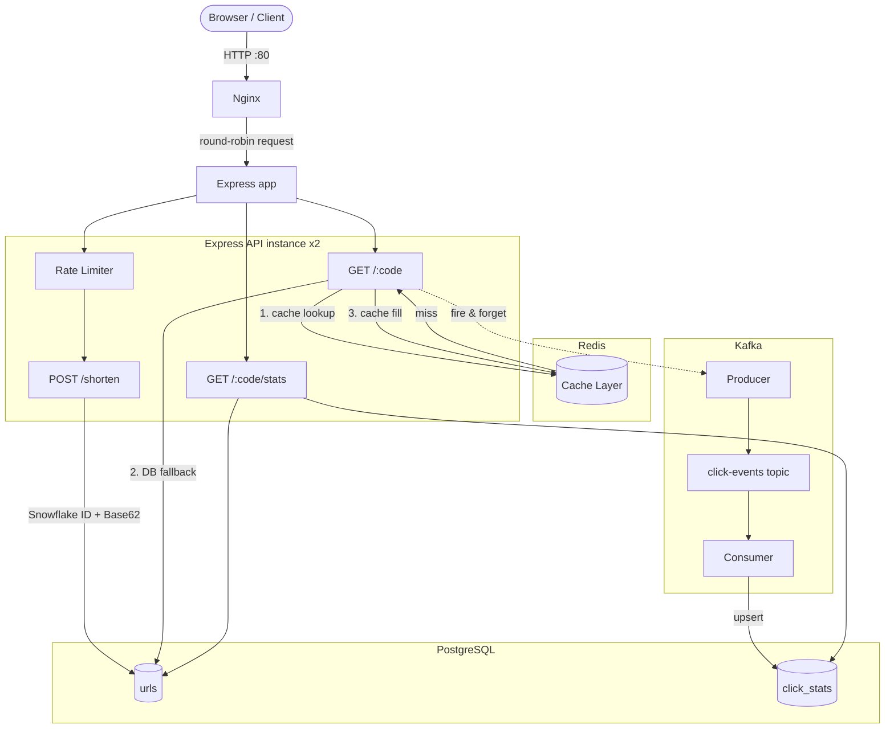

# Distributed URL Shortener

A learning-project URL shortener with production-style components built with Node.js, Express, PostgreSQL, Redis, and Kafka. 

## Architecture



## Stack

| Layer | Technology | Why |
|-------|-----------|-----|
| API | Node.js + Express | Fast, non-blocking I/O |
| Database | PostgreSQL 15 | Durable, ACID, indexed |
| Cache | Redis 7 | Fast cache lookups (not load tested) |
| ID generation | Snowflake (custom) | Time-ordered, no coordination |
| URL encoding | Base62 | URL-safe, short, human-readable |
| Analytics | Kafka + KafkaJS | Decouples analytics from redirect critical path |
| Edge / load balancer | Nginx | Round-robins traffic across two API instances |
| Container | Docker Compose | Local multi-service setup with two API instances |

## Running locally

**Prerequisites:** Docker and Docker Compose.

```bash
git clone <repo-url>
cd url-shortener
docker compose up --build
```

The public app is available at `http://localhost` (port 80). Nginx round-robins requests between two Express instances. PostgreSQL, Redis, ZooKeeper, and Kafka also start automatically; the database schema is created on boot.

> **Note:** Kafka can take ~20–30 seconds to become ready after `docker compose up`. Each API instance starts serving HTTP after PostgreSQL is ready; if Kafka is not ready yet the consumer retries with backoff until it connects.

### Run tests (no Docker required)

```bash
npm install
npm test
```

64 tests across 5 suites. All infrastructure (Postgres, Redis, Kafka) is mocked.

## API Reference

### `POST /shorten`

Shorten a URL, with an optional custom alias and TTL.

**Rate limit:** 10 requests per IP per minute.

```
POST /shorten
Content-Type: application/json
```

| Field | Type | Required | Description |
|-------|------|----------|-------------|
| `url` | string | ✅ | Must be `http://` or `https://` |
| `alias` | string | ❌ | 3–9 chars, alphanumeric + hyphens only |
| `ttl_days` | number | ❌ | Expiry in days from now (1–3650) |

**201 Created**
```json
{
  "short_url": "http://localhost/abc123",
  "short_code": "abc123",
  "expires_at": "2025-07-01T00:00:00.000Z"
}
```

**Error responses**

| Status | Condition |
|--------|-----------|
| `400` | Invalid URL or alias format |
| `409` | Custom alias already taken |
| `429` | Rate limit exceeded |

---

### `GET /:code`

Redirect to the original URL.

| Status | Condition |
|--------|-----------|
| `307` | Temporary redirect to `long_url` (cached for 5 min or until expiry) |
| `404` | Code not found |
| `410` | URL has expired |

**Caching:** Uses `Cache-Control: public, max-age=300` (5 minutes) to avoid repeat requests from the same browser (savings not measured); clicks served from a browser cache are not counted. Cache TTL automatically reduced if URL expires sooner.

---

### `GET /:code/stats`

Retrieve click analytics for a short URL.

**200 OK**
```json
{
  "short_code": "abc123",
  "long_url": "https://example.com/very/long/path",
  "total_clicks": 1042,
  "clicks_by_day": [
    { "date": "2025-06-18", "count": 312 },
    { "date": "2025-06-17", "count": 420 }
  ]
}
```

| Status | Condition |
|--------|-----------|
| `200` | Stats returned (zero clicks is valid) |
| `404` | Code not found |

---

## Design decisions

### Why Snowflake IDs instead of UUID or auto-increment?

UUIDs are random — every `INSERT` lands at a random position in the B-tree index, causing page splits and cache misses at scale. Auto-increment requires a sequence lock that doesn't work across multiple processes without coordination.

Snowflake IDs are 64-bit integers composed of: `| 41-bit timestamp | 10-bit worker ID | 12-bit sequence |`. They are monotonically increasing, so new rows always append to the end of the index. Worker ID (set via `WORKER_ID` env var) ensures uniqueness across instances without coordination. 4,096 IDs/ms/worker ≈ 4 million IDs/sec/worker.

### Why Base62 and not UUID strings as short codes?

Base62 (`0-9a-zA-Z`) avoids URL-unsafe characters (`+`, `/`, `=` from Base64). Generated codes are currently 10 characters (11 from 2030) because the Snowflake timestamp occupies the high bits; custom aliases are 3-9 characters so the two never overlap. Short, human-readable, and typeable. The code is derived directly from the Snowflake ID via `encode(id)`, so no extra DB lookup is needed to confirm uniqueness.

### Why 307 with 5-minute caching?

`307` (Temporary Redirect) with `Cache-Control: public, max-age=300` provides the best balance:
- **Browser caching:** Repeat clicks from the same browser within 5 minutes never reach the server (savings not measured)
- **Analytics:** Counts requests that reach the service; cached repeat clicks within the window are not counted
- **TTL respect:** Automatically caches for min(5 min, URL expiry time)
- **Performance:** Each new visitor to a viral link still hits the origin once; only repeat clicks are saved

**Alternatives:**
- `301` (Permanent): Cached forever, even after URL expires
- `302` (no cache): Every click hits server - can't handle viral traffic

**Key insight:** The cache window is a dial between origin load and analytics accuracy. For exact click tracking, use `no-store` (or `max-age=0`) for specific URLs.

See [docs/CACHING_STRATEGY.md](docs/CACHING_STRATEGY.md) for details.

### Why cache-aside and not write-through?

Write-through caches every URL on creation, even ones never clicked. Cache-aside is lazy: only URLs that are actually read get cached. Cache hit rates are higher because memory only holds hot data. A Redis failure degrades to direct PostgreSQL reads — redirects still work.

### Why Kafka instead of writing analytics directly to PostgreSQL on each redirect?

A synchronous DB write on the redirect path adds latency to every click. At 10,000 redirects/sec, that's 10,000 concurrent DB writes — the pool saturates quickly. Kafka decouples it: the redirect does not wait on the write, the consumer aggregates clicks at its own pace. The consumer can lag without affecting user-facing latency. Raw events are stored in `click_events` with UUID-based deduplication, so at-least-once Kafka delivery does not double-count successfully persisted events.

### What breaks at 10x load and how to fix it?

| Component | Bottleneck at 10x | Fix |
|-----------|------------------|-----|
| PostgreSQL writes | Connection pool exhaustion | PgBouncer connection pooler + read replicas |
| Redis | Hot key (one viral URL) | Per-process LRU cache (L1) in front of Redis |
| API instances | CPU-bound JSON + routing | Add replicas behind Nginx with unique `WORKER_ID`s |
| Kafka consumer | Slow aggregation lag | More partitions + more consumer instances (same `groupId`) |

## Project structure

```
url-shortener/
├── src/
│   ├── routes/
│   │   ├── shorten.js        # POST /shorten
│   │   ├── redirect.js       # GET /:code
│   │   └── stats.js          # GET /:code/stats
│   ├── services/
│   │   ├── shortener.js      # shorten + resolve logic
│   │   └── analytics.js      # stats query logic
│   ├── utils/
│   │   ├── base62.js         # encode/decode
│   │   └── snowflake.js      # Snowflake ID generator
│   ├── cache/
│   │   └── redis.js          # ioredis client + helpers
│   ├── db/
│   │   └── postgres.js       # pg pool + initSchema
│   ├── kafka/
│   │   ├── producer.js       # click event emitter
│   │   └── consumer.js       # click event aggregator
│   └── middleware/
│       ├── rateLimiter.js    # express-rate-limit + Redis store
│       └── errorHandler.js   # global 500 handler
├── frontend/
│   └── index.html            # minimal UI
├── tests/
│   ├── base62.test.js
│   ├── snowflake.test.js
│   ├── shorten.test.js
│   └── stats.test.js
├── nginx.conf                  # Nginx load balancer configuration
├── docker-compose.yml          # Nginx + two app replicas + infrastructure
├── Dockerfile
└── .env.example
```
